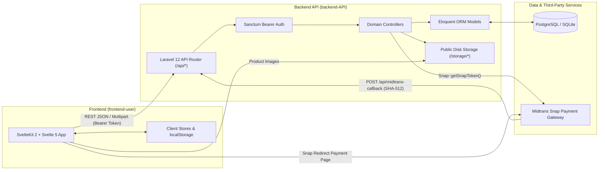

# Ascending PC (`ascending-pc`)

**Ascending PC** is a full-stack multi-vendor PC hardware, custom PC builder (*Simulasi PC*), and pre-built desktop (*PC Ready*) e-commerce web application (originally developed for the *Platform-Based Programming / PBP* Final Exam / UAS). It pairs a **Laravel 12 REST API** (`backend-API`, internally named `tsugi-backend`) with a **SvelteKit 2 + Svelte 5 + Tailwind CSS v4** storefront and seller portal (`frontend-user`), integrated with **Laravel Sanctum** bearer authentication and **Midtrans Snap** payment processing.

---

## Documentation Index

Comprehensive technical documentation for the entire monorepo is organized under [`docs/`](./docs/):

| Document | Scope & Contents |
| :--- | :--- |
| [**System Architecture** (`docs/ARCHITECTURE.md`)](./docs/ARCHITECTURE.md) | High-level topology, request lifecycle, Sanctum auth flow, multi-vendor order splitting, Midtrans Snap payment workflow, and PC Builder compatibility engine. |
| [**Database Reference** (`docs/DATABASE.md`)](./docs/DATABASE.md) | Entity-Relationship diagram (`erDiagram`), table-by-table column specifications, JSON `details` schema, Eloquent relationships, accessors, seeders, and schema discrepancies. |
| [**REST API Reference** (`docs/API_REFERENCE.md`)](./docs/API_REFERENCE.md) | Complete endpoint catalog (`/api/*`), auth requirements, validation rules, request/response JSON examples, status codes, and Midtrans webhook verification. |
| [**Frontend Guide** (`docs/FRONTEND.md`)](./docs/FRONTEND.md) | SvelteKit route map, UI component library, Svelte stores (`auth`, `user`, `cart`, `wishlist`), API integration matrix, styling setup, and legacy/orphaned file inventory. |
| [**Audit & Improvement Roadmap** (`docs/IMPROVEMENTS.md`)](./docs/IMPROVEMENTS.md) | Prioritized security, backend, database, frontend, UX, and DevOps audit findings (`P0`–`P3`) with exact `file:line` locations and actionable fixes. |

---

## High-Level Architecture



---

## Core Platform Capabilities

- **Hardware Catalog & Search**: Browse PC components across categories (`processor`, `motherboard`, `cooler`, `vga`, `ram`, `storage`, `casing`, `psu`, `monitor`, `pc-ready`) with keyword search, price range filtering, sorting, and pagination.
- **Custom PC Builder (*Simulasi PC*)**: Interactive 9-slot configurator (`/web/simulasi-pc`) with CPU-to-Motherboard socket matching (`AM4`, `AM5`, `LGA1700`) and Motherboard-to-RAM memory generation matching (`DDR4`, `DDR5`), live subtotal calculation, and bulk add-to-cart.
- **Pre-Built Systems (*PC Ready*)**: Dedicated catalog (`/web/pc-ready`) for turnkey gaming and workstation builds.
- **Shopping Cart & Wishlist**: Persistent server-backed cart with slide-out drawer (`CartDrawer`), selective item checkbox checkout, stock validation on quantity updates, and product wishlists.
- **Multi-Vendor Order Splitting & Midtrans Checkout**: Single buyer checkout (`ParentOrder`) automatically partitions items by seller into independent shipment groups (`VendorOrder` + `OrderItem`), calculates platform commissions, generates a Midtrans Snap payment token, and processes asynchronous payment status webhooks (`/api/midtrans-callback`).
- **Self-Service Vendor Portal**: Any authenticated buyer can register a store (`/registervendor`) and access the Seller Dashboard (`/web/dashboard`) to list products with compatibility metadata, track inventory, and fulfill vendor orders (`pending` -> `processing` -> `shipped` -> `delivered`).

---

## Repository Structure

```text
ascending-pc/
├── backend-API/                 # Laravel 12 REST API ("tsugi-backend")
│   ├── app/
│   │   ├── Http/
│   │   │   ├── Controllers/     # Auth, Product, Vendor, Cart, WishList, Order, VendorOrder
│   │   │   └── Resources/       # Eloquent JSON Resources (ParentOrder, VendorOrder, OrderItem)
│   │   ├── Models/              # User, Vendor, Product, Cart, WishList, ParentOrder, VendorOrder, OrderItem, payout
│   │   └── Providers/           # AppServiceProvider (Midtrans SDK bootstrap)
│   ├── bootstrap/               # Laravel 12 app routing & CSRF configuration
│   ├── config/                  # app, auth, cors, database, filesystems, midtrans, sanctum
│   ├── database/
│   │   ├── factories/           # UserFactory
│   │   ├── migrations/          # Core Laravel + 9 marketplace migrations
│   │   └── seeders/             # DatabaseSeeder, vendorSeeder, productsSeeder, cartSeeder
│   ├── routes/                  # api.php (/api/*), web.php, console.php
│   └── tests/                   # Pest v4 test scaffolding
├── frontend-user/               # SvelteKit 2 + Svelte 5 + Tailwind CSS v4 SPA/SSR client
│   ├── src/
│   │   ├── lib/
│   │   │   ├── components/      # Header, Footer, ProductCard, CartDrawer, UserMenu, Carousels
│   │   │   ├── data/            # Legacy static mock datasets
│   │   │   └── stores/          # Svelte writable stores (auth, user, cart, wishlist)
│   │   └── routes/              # Landing, Auth, Buyer Storefront (/web/*), Vendor Dashboard
│   └── static/                  # Static banners, category icons, robots.txt
└── docs/                        # Project technical documentation & audit reports
```

---

## Tech Stack Summary

| Layer | Technology | Version |
| :--- | :--- | :--- |
| **Backend Framework** | Laravel Framework | `^12.0` (`v12.42.0` locked) |
| **Backend Runtime** | PHP | `^8.2` (`>=8.4` required by current `composer.lock`; see [Improvements](./docs/IMPROVEMENTS.md)) |
| **Authentication** | Laravel Sanctum (Personal Access Tokens) | `^4.0` (`v4.2.1`) |
| **Payment Gateway** | Midtrans PHP SDK (`midtrans/midtrans-php`) | `^2.6` (`2.6.2`) |
| **Database** | PostgreSQL (default in `.env.example`) / SQLite | PostgreSQL 15+ / SQLite 3 |
| **Frontend Framework** | SvelteKit + Svelte | `@sveltejs/kit ^2.47.1`, `svelte ^5.41.0` |
| **Styling & Bundler** | Tailwind CSS v4 + Vite 7 | `tailwindcss ^4.1.17`, `vite ^7.1.10` |
| **Deployment Adapter** | `@sveltejs/adapter-node` | `^5.4.0` |

---

## Local Development Quickstart

### Prerequisites

- **PHP** `8.4+` (or run `composer update` under PHP `8.2`/`8.3` to regenerate `composer.lock`) with `pdo_pgsql` / `pdo_sqlite`, `mbstring`, `openssl`, `gd`/`fileinfo` extensions
- **Composer** `2.x`
- **Node.js** `20+` and **npm** `10+`
- **PostgreSQL** `15+` (or SQLite for quick local testing)
- **Midtrans Sandbox Account** (Server Key & Client Key)

### 1. Backend Setup (`backend-API`)

```bash
cd backend-API

# 1. Install PHP dependencies
composer install

# 2. Create environment file and configure DB + Midtrans keys
cp .env.example .env

# 3. Generate application key & public storage symlink
php artisan key:generate
php artisan storage:link

# 4. Run database migrations
php artisan migrate

# 5. Start the API server (http://127.0.0.1:8000)
php artisan serve
```

### 2. Frontend Setup (`frontend-user`)

```bash
cd frontend-user

# 1. Install Node dependencies
npm install

# 2. Copy environment template (required at compile time by $env/static/public)
cp .env.example .env

# 3. Start Vite dev server (http://localhost:5173)
npm run dev
```

---

## Environment Variables Reference

### Backend (`backend-API/.env`)

| Variable | Example / Default | Purpose |
| :--- | :--- | :--- |
| `APP_NAME` | `tsugi-backend` | Application identifier |
| `APP_URL` | `http://localhost:8000` | Base URL used by `asset('storage/...')` for image URLs |
| `DB_CONNECTION` | `pgsql` (or `sqlite`) | Primary database driver |
| `DB_HOST` / `DB_PORT` | `127.0.0.1` / `5432` | Database host and port |
| `DB_DATABASE` | `backend_api` | Database name |
| `DB_USERNAME` / `DB_PASSWORD` | `postgres` / `secret` | Database credentials |
| `FILESYSTEM_DISK` | `local` | Default disk (`ProductController` explicitly uses `'public'` disk) |
| `MIDTRANS_SERVER_KEY` | `SB-Mid-server-...` | Midtrans Server Key for Snap token creation & webhook SHA-512 verification |
| `MIDTRANS_CLIENT_KEY` | `SB-Mid-client-...` | Midtrans Client Key |
| `MIDTRANS_IS_PRODUCTION` | `false` | `false` for Sandbox, `true` for Production |
| `MIDTRANS_IS_SANITIZED` | `true` | Enables Midtrans input sanitization |
| `MIDTRANS_IS_3DS` | `true` | Enables 3D Secure for card transactions |

### Frontend (`frontend-user/.env`)

| Variable | Example | Purpose |
| :--- | :--- | :--- |
| `PUBLIC_API_URL` | `http://127.0.0.1:8000/api` | Base URL for all backend REST calls (no trailing slash) |
| `PUBLIC_STORAGE_URL` | `http://127.0.0.1:8000` | Backend origin used to resolve `/storage/...` image paths |
