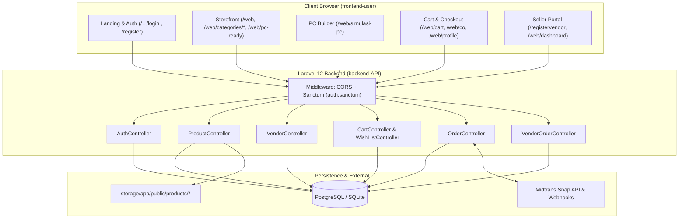
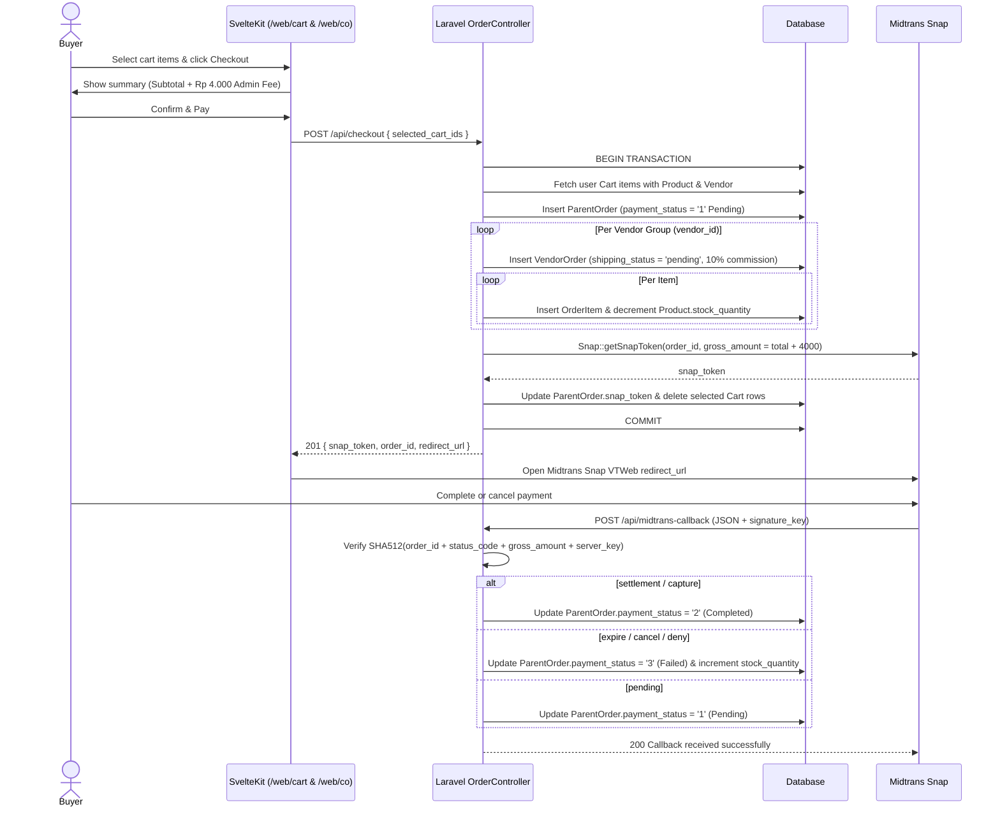
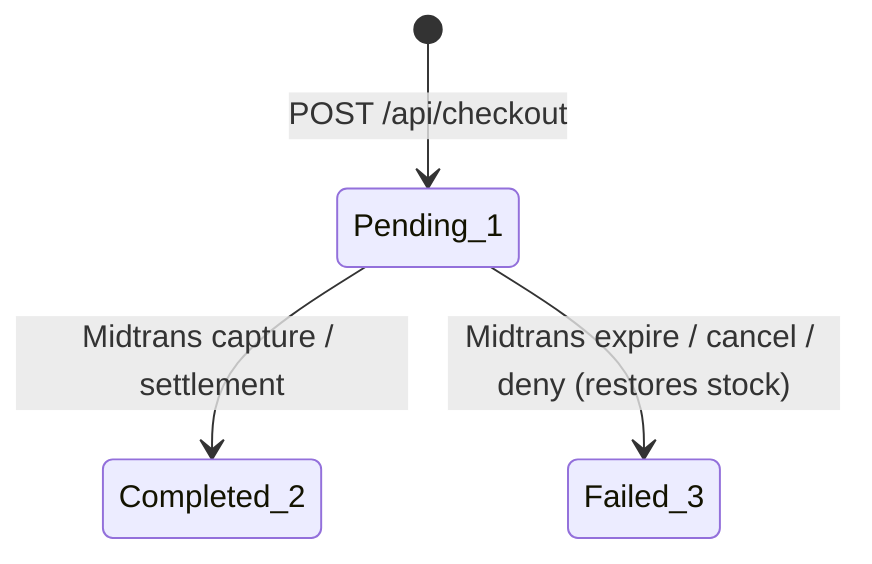
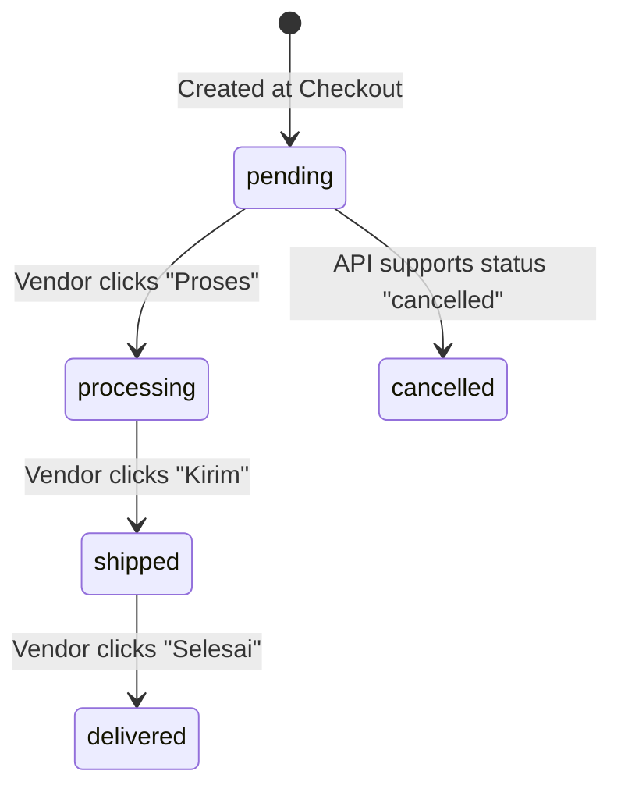

# System Architecture (`ascending-pc`)

This document describes the system topology, domain model, authentication architecture, multi-vendor order lifecycle, payment integration, and PC compatibility engine across `backend-API/` and `frontend-user/`.

---

## 1. Monorepo Overview

`ascending-pc` is structured as a decoupled two-tier web application within a single Git repository:

1. **`backend-API/` (`tsugi-backend`)**: A stateless **Laravel 12** JSON REST API serving product catalog queries, Sanctum token authentication, cart/wishlist persistence, multi-vendor order splitting, vendor order fulfillment, local public-disk image storage, and Midtrans Snap payment webhooks.
2. **`frontend-user/`**: A **SvelteKit 2** (`svelte ^5.41.0`, `@sveltejs/adapter-node`) web application serving both **Buyers** (landing page, catalog, PC Builder, cart, wishlist, checkout, order history) and **Vendors** (onboarding form and Seller Dashboard).

---

## 2. Authentication & Role Model

### 2.1 Stateless Bearer Authentication
- **Mechanism**: Laravel Sanctum Personal Access Tokens (`personal_access_tokens` table) configured in `backend-API/config/sanctum.php` with a token expiration of `131,400` minutes (~91.25 days).
- **Issuance**:
  - `POST /api/register` creates a `User` row with `bcrypt` password hashing and returns `access_token` (`plainTextToken`).
  - `POST /api/login` verifies credentials via `Auth::attempt()` and issues a new `auth_token` `plainTextToken`.
- **Client Storage**: `frontend-user` stores `auth_token` and serialized `user_data` in `window.localStorage` and attaches `Authorization: Bearer <token>` on protected `fetch()` calls.
- **Revocation**: `POST /api/logout` deletes `$request->user()->currentAccessToken()`.

### 2.2 Buyer-to-Vendor Upgrade Model
Rather than maintaining a separate `role` column or separate login guard for sellers, vendor status is modeled relationally:
- Every account begins as a standard `User` (buyer).
- `User::vendor()` defines a `1:1` `hasOne(Vendor::class)` relationship, exposed dynamically on every serialized `User` JSON object via `$appends = ['is_vendor']` (`User::getIsVendorAttribute()`).
- Calling `POST /api/vendor/register` creates the associated `vendors` record (`commission_rate: 5.00`, `balance: 0.00`), immediately unlocking seller endpoints (`POST /api/product`, `GET /api/vendor/profile`, `GET /api/vendor/orders`, `PATCH /api/vendor/orders/{id}/status`).

---

## 3. Product Catalog & Flexible JSON `details` Bucket

Hardware products vary widely in technical attributes (CPU sockets, RAM generations, GPU VRAM, PSU wattage). Instead of EAV tables or dozens of nullable columns, `products` uses a hybrid relational + JSON design:

- **Relational Columns** (indexed/sortable): `id`, `vendor_id`, `title`, `price`, `stock_quantity`, `created_at`, `updated_at`.
- **Flexible JSON Column (`details`)**:
  - `category`: e.g., `"processor"`, `"motherboard"`, `"cooler"`, `"vga"`, `"ram"`, `"storage"`, `"casing"`, `"psu"`, `"monitor"`, `"pc-ready"` (queried in SQL via `->where('details->category', $category)`).
  - `description`: Long-form product description.
  - `socket`: Hardware socket (`"AM4"`, `"AM5"`, `"LGA1700"`, `"LGA1200"`).
  - `memory`: Memory standard (`"DDR4"`, `"DDR5"`).
  - `specs`: Summary specification string.
  - `images`: `{ "main": "products/main/...", "gallery": ["products/gallery/..."] }`.
- **Computed Accessors (`Product.php`)**:
  - `image_url`: Resolves `details.images.main` to a full URL via `asset('storage/' . $path)` (or passes through `http*` URLs).
  - `category`: Extracts `details.category` (defaults to `'uncategorized'`).

---

## 4. Multi-Vendor Checkout & Midtrans Payment Lifecycle

A single buyer cart can contain items from multiple independent vendors. `OrderController@checkout` implements a **Parent-Child Order Splitting** pattern:

1. **Parent Order (`parent_orders`)**: Represents the buyer's single financial payment transaction (`total_amount`, `payment_status`, `snap_token`).
2. **Vendor Orders (`vendor_orders`)**: One record per distinct `vendor_id` in the checked-out cart, tracking vendor-specific fulfillment (`shipping_status`) and platform fee accounting (`order_total`, `commission_fee`, `net_amount`).
3. **Order Items (`order_items`)**: Line items attached to each `VendorOrder` with a `unit_price` snapshot at purchase time.

### Checkout & Webhook Sequence

### Order & Fulfillment State Machines

#### Buyer Payment Status (`parent_orders.payment_status`)

*(Enum `'4'` = Refunded is defined in the database migration for future refund workflows.)*

#### Vendor Fulfillment Status (`vendor_orders.shipping_status`)

---

## 5. Custom PC Builder (*Simulasi PC*) Engine

Located in `frontend-user/src/routes/web/simulasi-pc/+page.svelte`, the PC Builder loads the catalog (`GET /api/product?per_page=100`) and guides buyers across 9 component slots:

1. `processor` (CPU)
2. `motherboard` (Motherboard)
3. `cooler` (CPU Cooler / HSF)
4. `ram` (Memory)
5. `vga` (Graphics Card)
6. `storage` (SSD / HDD)
7. `psu` (Power Supply)
8. `casing` (PC Case)
9. `monitor` (Display)

### Compatibility Filtering Logic
- **Tag Inference**: When sellers create products in `/web/dashboard`, compatibility tags (`details.socket`, `details.memory`, `details.specs`) are stored in `products.details`. On load, `simulasi-pc` combines `product.title` and `product.details.specs` in uppercase to match hardware tokens.
- **CPU <-> Motherboard Constraint**: If a CPU is chosen with `AM5`, `AM4`, or `LGA1700`, incompatible Motherboards are filtered out (and vice versa).
- **Motherboard <-> RAM Constraint**: If a Motherboard specifies `DDR4` or `DDR5`, RAM modules of a different generation are hidden.
- **Bulk Cart Submission**: Selecting quantities per slot and clicking *Masukkan Keranjang* iterates sequentially over selected slots and dispatches `POST /api/cart/{productId}` requests.

---

## 6. Media & Static Asset Architecture

- **Uploaded Product Media**: Stored by `ProductController@store` and `ProductController@update` onto Laravel's `'public'` disk (`backend-API/storage/app/public/products/main` and `products/gallery`). Exposed publicly at `http://<backend-host>/storage/products/...` once `php artisan storage:link` creates the `public/storage` symlink.
- **Frontend Static Media**: Promotional banners (`/images/banner-utama.jpg`, `/images/promo.jpg`, `/images/pc-ready.jpg`) and category icons (`/images/icons/*.png`) are served directly by SvelteKit from `frontend-user/static/images/`.
