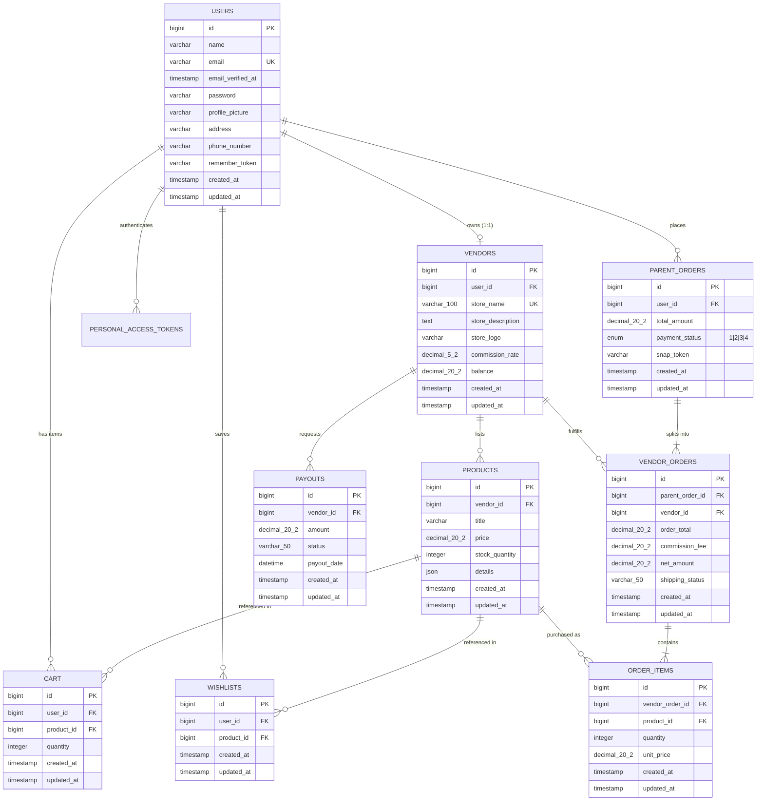

# Database Schema & Eloquent ORM Reference

This document details all database tables, migrations, foreign keys, JSON schemas, Eloquent models, seeders, and known schema-vs-code discrepancies in `backend-API/`.

---

## 1. Database Configuration

- **Default Production/Dev Driver** (`.env.example`): PostgreSQL (`DB_CONNECTION=pgsql`, port `5432`, database `backend_api`).
- **Fallback Driver** (`config/database.php`) & **Test Runner** (`phpunit.xml`): SQLite (`database/database.sqlite` or `:memory:`).
- **Migrations Directory**: `backend-API/database/migrations/` (12 migration files total: 3 Laravel core + 1 Sanctum + 8 marketplace tables).

---

## 2. Entity-Relationship Diagram



---

## 3. Domain Table Specifications

### 3.1 `users`
- **Migration**: `0001_01_01_000000_create_users_table.php`
- **Model**: `App\Models\User` (`app/Models/User.php`)

| Column | SQL Type | Nullable | Default | Constraints / Notes |
| :--- | :--- | :--- | :--- | :--- |
| `id` | `BIGINT UNSIGNED` | No | Auto | Primary Key |
| `name` | `VARCHAR(255)` | No | - | Full name |
| `email` | `VARCHAR(255)` | No | - | `UNIQUE` |
| `email_verified_at` | `TIMESTAMP` | Yes | `NULL` | Cast to `datetime` |
| `password` | `VARCHAR(255)` | No | - | `hashed` cast / `bcrypt` |
| `profile_picture` | `VARCHAR(255)` | Yes | `NULL` | Storage path (not currently uploaded by any endpoint) |
| `address` | `VARCHAR(255)` | Yes | `NULL` | Shipping/contact address (note: `AuthController@update` allows up to 1000 chars!) |
| `phone_number` | `VARCHAR(255)` | Yes | `NULL` | Validated `max:20` in controllers |
| `remember_token` | `VARCHAR(100)` | Yes | `NULL` | Hidden on serialization |
| `created_at` / `updated_at` | `TIMESTAMP` | Yes | `NULL` | Eloquent timestamps |

*(The same migration file also creates `password_reset_tokens` and `sessions`; `0001_01_01_000001` creates `cache` & `cache_locks`; `0001_01_01_000002` creates `jobs`, `job_batches`, & `failed_jobs`; `2025_11_19_192237` creates Sanctum's `personal_access_tokens`.)*

---

### 3.2 `vendors`
- **Migration**: `2025_11_25_040910_create_vendor_table.php`
- **Model**: `App\Models\Vendor` (`app/Models/Vendor.php`)

| Column | SQL Type | Nullable | Default | Constraints / Notes |
| :--- | :--- | :--- | :--- | :--- |
| `id` | `BIGINT UNSIGNED` | No | Auto | Primary Key |
| `user_id` | `BIGINT UNSIGNED` | No | - | FK -> `users(id)` `ON DELETE CASCADE` (missing `UNIQUE` index) |
| `store_name` | `VARCHAR(100)` | No | - | `UNIQUE` (note: controller validates `max:255`) |
| `store_description` | `TEXT` | Yes | `NULL` | Store bio |
| `store_logo` | `VARCHAR(255)` | Yes | `NULL` | Storage path for logo |
| `commission_rate` | `DECIMAL(5,2)` | No | `5.00` | Percentage rate (note: `OrderController` currently hardcodes 10%) |
| `balance` | `DECIMAL(20,2)` | No | `0.00` | Withdrawable earnings balance |
| `created_at` / `updated_at` | `TIMESTAMP` | Yes | `NULL` | Eloquent timestamps |

---

### 3.3 `products`
- **Migration**: `2025_11_25_042158_create_products_table.php`
- **Model**: `App\Models\Product` (`app/Models/Product.php`)

| Column | SQL Type | Nullable | Default | Constraints / Notes |
| :--- | :--- | :--- | :--- | :--- |
| `id` | `BIGINT UNSIGNED` | No | Auto | Primary Key |
| `vendor_id` | `BIGINT UNSIGNED` | No | - | FK -> `vendors(id)` `ON DELETE CASCADE` |
| `title` | `VARCHAR(255)` | No | - | Product display name |
| `price` | `DECIMAL(20,2)` | No | - | Unit price in IDR (`decimal:2` cast) |
| `stock_quantity` | `INTEGER` | No | `0` | Available units (`integer` cast) |
| `details` | `JSON` | Yes | `NULL` | Flexible metadata & image paths (`array` cast) |
| `created_at` / `updated_at` | `TIMESTAMP` | Yes | `NULL` | Eloquent timestamps |

#### Canonical `products.details` JSON Structure
```json
{
  "category": "processor",
  "description": "8-Core 16-Thread Desktop Processor",
  "specs": "[Socket: AM5] [Mem: DDR5]",
  "socket": "AM5",
  "memory": "DDR5",
  "images": {
    "main": "products/main/abc123.webp",
    "gallery": [
      "products/gallery/img1.webp",
      "products/gallery/img2.webp"
    ]
  }
}
```

---

### 3.4 `cart`
- **Migration**: `2025_12_05_072358_create_cart_table.php`
- **Model**: `App\Models\Cart` (`app/Models/Cart.php`, `$table = 'cart'`)

| Column | SQL Type | Nullable | Default | Constraints / Notes |
| :--- | :--- | :--- | :--- | :--- |
| `id` | `BIGINT UNSIGNED` | No | Auto | Primary Key |
| `user_id` | `BIGINT UNSIGNED` | No | - | FK -> `users(id)` `ON DELETE CASCADE` |
| `product_id` | `BIGINT UNSIGNED` | No | - | FK -> `products(id)` `ON DELETE CASCADE` |
| `quantity` | `INTEGER` | No | `1` | Item count |
| `created_at` / `updated_at` | `TIMESTAMP` | Yes | `NULL` | Eloquent timestamps |

---

### 3.5 `wishlists`
- **Migration**: `2025_12_12_063525_create_wishlists_table.php`
- **Model**: `App\Models\WishList` (`app/Models/WishList.php`, `$table = 'wishlists'`)

| Column | SQL Type | Nullable | Default | Constraints / Notes |
| :--- | :--- | :--- | :--- | :--- |
| `id` | `BIGINT UNSIGNED` | No | Auto | Primary Key |
| `user_id` | `BIGINT UNSIGNED` | No | - | FK -> `users(id)` `ON DELETE CASCADE` |
| `product_id` | `BIGINT UNSIGNED` | No | - | FK -> `products(id)` `ON DELETE CASCADE` |
| `created_at` / `updated_at` | `TIMESTAMP` | Yes | `NULL` | Composite `UNIQUE(user_id, product_id)` |

---

### 3.6 `parent_orders`
- **Migrations**: `2025_11_25_042600_create_parent_orders_table.php` + `2025_12_16_000001_align_schema_constraints_and_order_metadata.php`
- **Model**: `App\Models\ParentOrder` (`app/Models/ParentOrder.php`)

| Column | SQL Type | Nullable | Default | Constraints / Notes |
| :--- | :--- | :--- | :--- | :--- |
| `id` | `BIGINT UNSIGNED` | No | Auto | Primary Key |
| `user_id` | `BIGINT UNSIGNED` | No | - | FK -> `users(id)` (restrict on delete) |
| `midtrans_order_id` | `VARCHAR(100)` | Yes | `NULL` | `UNIQUE` collision-free Midtrans `order_id` (`ASC-{id}-{timestamp}`) |
| `total_amount` | `DECIMAL(20,2)` | No | - | Grand total billed (`subtotal + admin_fee`) |
| `admin_fee` | `DECIMAL(20,2)` | No | `0.00` | Platform service fee snapshot (`4000.00`) |
| `payment_status` | `ENUM('1','2','3','4')` | No | `'1'` | `'1'` Pending, `'2'` Completed, `'3'` Failed, `'4'` Refunded |
| `snap_token` | `VARCHAR(255)` | Yes | `NULL` | Midtrans Snap payment token |
| `shipping_address` | `TEXT` | Yes | `NULL` | Buyer shipping address snapshot at checkout |
| `recipient_phone` | `VARCHAR(30)` | Yes | `NULL` | Buyer phone number snapshot at checkout |
| `snap_redirect_url` | `VARCHAR(500)` | Yes | `NULL` | Environment-aware Midtrans Snap redirect URL |
| `created_at` / `updated_at` | `TIMESTAMP` | Yes | `NULL` | Eloquent timestamps |

---

### 3.7 `vendor_orders`
- **Migration**: `2025_11_25_042623_create_vendors_orders_table.php`
- **Model**: `App\Models\VendorOrder` (`app/Models/VendorOrder.php`)

| Column | SQL Type | Nullable | Default | Constraints / Notes |
| :--- | :--- | :--- | :--- | :--- |
| `id` | `BIGINT UNSIGNED` | No | Auto | Primary Key |
| `parent_order_id` | `BIGINT UNSIGNED` | No | - | FK -> `parent_orders(id)` |
| `vendor_id` | `BIGINT UNSIGNED` | No | - | FK -> `vendors(id)` |
| `order_total` | `DECIMAL(20,2)` | No | - | Gross vendor subtotal |
| `commission_fee` | `DECIMAL(20,2)` | No | - | Platform fee deducted (`vendors.commission_rate`) |
| `net_amount` | `DECIMAL(20,2)` | No | - | Vendor net receivable (`order_total - commission_fee`) |
| `shipping_status` | `VARCHAR(50)` | No | `'processing'` | Set to `'pending'` on checkout; transitions through `'processing'`, `'shipped'`, `'delivered'`, `'cancelled'` |
| `created_at` / `updated_at` | `TIMESTAMP` | Yes | `NULL` | Eloquent timestamps |

---

### 3.8 `order_items`
- **Migration**: `2025_11_25_042703_create_order_items_table.php`
- **Model**: `App\Models\OrderItem` (`app/Models/OrderItem.php`)

| Column | SQL Type | Nullable | Default | Constraints / Notes |
| :--- | :--- | :--- | :--- | :--- |
| `id` | `BIGINT UNSIGNED` | No | Auto | Primary Key |
| `vendor_order_id` | `BIGINT UNSIGNED` | No | - | FK -> `vendor_orders(id)` |
| `product_id` | `BIGINT UNSIGNED` | No | - | FK -> `products(id)` |
| `quantity` | `INTEGER` | No | - | Units ordered |
| `unit_price` | `DECIMAL(20,2)` | No | - | Price snapshot at checkout |
| `created_at` / `updated_at` | `TIMESTAMP` | Yes | `NULL` | Eloquent timestamps |

---

### 3.9 `payouts`
- **Migration**: `2025_11_25_042939_create_payouts_table.php`
- **Model**: `App\Models\Payout` (`app/Models/Payout.php`)

| Column | SQL Type | Nullable | Default | Constraints / Notes |
| :--- | :--- | :--- | :--- | :--- |
| `id` | `BIGINT UNSIGNED` | No | Auto | Primary Key |
| `vendor_id` | `BIGINT UNSIGNED` | No | - | FK -> `vendors(id)` |
| `amount` | `DECIMAL(20,2)` | No | - | Requested withdrawal amount |
| `status` | `VARCHAR(50)` | No | `'pending'` | Payout approval status |
| `payout_date` | `DATETIME` | Yes | `NULL` | Completion timestamp |
| `created_at` / `updated_at` | `TIMESTAMP` | Yes | `NULL` | Eloquent timestamps |

---

## 4. Eloquent Model Relationships & Accessors Summary

| Model | Defined Relationships | Appended / Custom Accessors |
| :--- | :--- | :--- |
| `User` | `vendor()` (`hasOne`), `parentOrders()` (`hasMany`), `cart()` / `Cart()` (`hasMany`), `wishlists()` (`hasMany`) | `$appends = ['is_vendor']`; `profile_picture_url` |
| `Vendor` | `user()` (`belongsTo`), `products()` (`hasMany`), `vendorOrders()` (`hasMany`), `payouts()` (`hasMany`) | `store_logo_url` |
| `Product` | `vendor()` / `Vendor()` (`belongsTo`) | `$appends = ['image_url', 'category']`; `gallery_urls` |
| `Cart` | `user()` (`belongsTo`), `product()` (`belongsTo`) | None |
| `WishList` | `product()` (`belongsTo`) | None |
| `ParentOrder` | `user()` (`belongsTo`), `vendorOrders()` (`hasMany`) | `$appends = ['redirect_url']` |
| `VendorOrder` | `parentOrder()` (`belongsTo`), `vendor()` (`belongsTo`), `orderItems()` (`hasMany`) | `$appends = ['total_price']` |
| `OrderItem` | `vendorOrder()` (`belongsTo`), `product()` (`belongsTo`) | None |
| `Payout` | `vendor()` (`belongsTo`) | None |

---

## 5. Seeders Overview (`database/seeders/`)

- `DatabaseSeeder.php`: Ensures `test@example.com` + 3 factory users exist, then invokes `VendorSeeder`, `ProductSeeder`, and `CartSeeder`.
- `VendorSeeder.php`: Creates active vendor storefronts (`commission_rate: 5.00`), guaranteeing at least one vendor exists.
- `ProductSeeder.php`: Seeds 12 realistic PC component and *PC Ready* fixtures across all catalog categories with `socket`, `memory`, `brand`, and `specs` metadata.
- `CartSeeder.php`: Idempotently seeds sample cart entries per user (`updateOrInsert` on `(user_id, product_id)`).

---

## 6. Schema & Migration Notes

- Migration `2025_12_16_000001_align_schema_constraints_and_order_metadata.php` widens `users.address` to `TEXT` and `vendors.store_name` to `VARCHAR(255)`, enforces `UNIQUE(user_id)` on `vendors` and `UNIQUE(user_id, product_id)` on `cart`, and adds `midtrans_order_id`, `admin_fee`, `shipping_address`, `recipient_phone`, and `snap_redirect_url` to `parent_orders`.
- `order_items` snapshots `unit_price` at checkout; `ProductController@destroy` prevents hard-deleting products that have historical `order_items` (`409 Conflict`).
