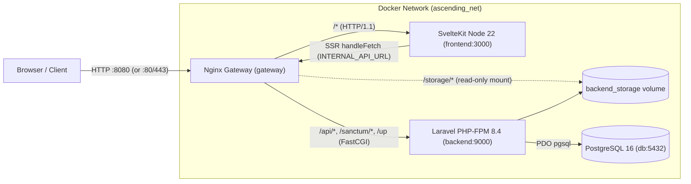

# Deployment & CI/CD Guide

This guide covers containerized deployment of **Ascending PC** with **Docker Compose** (both local/self-hosted builds and prebuilt GHCR production images) and the automated **GitHub Actions CI/CD pipeline**.

---

## Container Topology

All services run behind a unified **Nginx Gateway** (`gateway`), eliminating cross-origin (CORS) issues in browsers while allowing SvelteKit SSR (`frontend`) to call the Laravel API over the internal Docker bridge network (`INTERNAL_API_URL=http://gateway/api`).



### Container Inventory

| Service | Image / Dockerfile | Role | Healthcheck |
| :--- | :--- | :--- | :--- |
| **`db`** | `postgres:16-alpine` | Primary PostgreSQL 16 database (`postgres_data` volume) | `pg_isready` |
| **`backend`** | [`backend-API/Dockerfile`](../backend-API/Dockerfile) | Multi-stage PHP 8.4-FPM Alpine + Laravel 12 (`pdo_pgsql`, `gd`, `opcache`) | FastCGI `/fpm-ping` -> `pong` |
| **`frontend`** | [`frontend-user/Dockerfile`](../frontend-user/Dockerfile) | Multi-stage Node 22 Alpine running SvelteKit `@sveltejs/adapter-node` as non-root `node` | `GET http://127.0.0.1:3000/` |
| **`gateway`** | [`docker/nginx/Dockerfile`](../docker/nginx/Dockerfile) | Nginx 1.27 Alpine reverse proxy, FastCGI router, and static `/storage/` file server | `GET http://127.0.0.1/up` |

---

## Quickstart: Local / Self-Hosted Docker Compose

1. **Copy the Docker environment template** at the repository root:

   ```bash
   cp .env.docker.example .env
   ```

2. **Edit `.env`** to set your PostgreSQL password and Midtrans Sandbox/Production keys. Optionally set `RUN_SEEDERS=true` on first boot to populate sample vendors and PC hardware products.

3. **Build and start the stack**:

   ```bash
   docker compose up --build -d
   ```

4. **Verify health and access the app**:

   - Storefront: `http://localhost:8080`
   - API Healthcheck: `http://localhost:8080/up`
   - Products API: `http://localhost:8080/api/product`

   ```bash
   docker compose ps
   docker compose logs -f backend frontend gateway
   ```

5. **Run one-off Artisan commands** inside the backend container:

   ```bash
   docker compose exec backend su-exec www-data php artisan db:seed --force
   docker compose exec backend su-exec www-data php artisan migrate:status
   ```

---

## Production Deployment with Prebuilt GHCR Images

The CI/CD pipeline publishes production images to GitHub Container Registry (`ghcr.io`) on every push to `master` and on `v*.*.*` release tags:

- `ghcr.io/ascendingheat/ascending-pc-backend:latest` (and `sha-<commit>`, `<semver>`)
- `ghcr.io/ascendingheat/ascending-pc-frontend:latest` (and `sha-<commit>`, `<semver>`)
- `ghcr.io/ascendingheat/ascending-pc-gateway:latest` (and `sha-<commit>`, `<semver>`)

### Manual Server Setup (`/opt/ascending-pc`)

1. Copy [`compose.prod.yaml`](../compose.prod.yaml) and [`.env.docker.example`](../.env.docker.example) to `/opt/ascending-pc/.env`.
2. Populate all mandatory production variables in `/opt/ascending-pc/.env`:
   - `APP_KEY` (generate via `php artisan key:generate --show` or `echo "base64:$(openssl rand -base64 32)"`)
   - `APP_URL` and `ASSET_URL` (e.g., `https://shop.example.com`)
   - `DB_PASSWORD` (strong unique password)
   - `MIDTRANS_SERVER_KEY`, `MIDTRANS_CLIENT_KEY`, `MIDTRANS_IS_PRODUCTION=true`
3. Pull and start containers:

   ```bash
   docker compose -f compose.prod.yaml pull
   docker compose -f compose.prod.yaml up -d
   ```

> [!IMPORTANT]
> Because SvelteKit reads `PUBLIC_API_URL` and `PUBLIC_STORAGE_URL` at **build time** (`$env/static/public`), set repository variables `PUBLIC_API_URL` and `PUBLIC_STORAGE_URL` in GitHub Actions (**Settings -> Secrets and variables -> Actions -> Variables**) before tagging a production release so the published `frontend` image embeds your public domain.

---

## GitHub Actions CI/CD Pipeline

Defined in [`.github/workflows/ci-cd.yml`](../.github/workflows/ci-cd.yml), the pipeline runs on every push (`master`, `staging`, `dev/**`, `v*.*.*`), pull request, and manual `workflow_dispatch`:

| Stage | Job | What It Verifies / Produces |
| :--- | :--- | :--- |
| **1. Backend CI** | `backend-ci` | PHP 8.4 + Composer install, Pest feature suite on SQLite `:memory:`, then `migrate:fresh --seed`, `migrate:rollback --step=1`, `migrate`, and full Pest suite against a live `postgres:16-alpine` service container. |
| **2. Frontend CI** | `frontend-ci` | Node 22 + `npm ci`, `svelte-kit sync`, and `npm run build` verifying `@sveltejs/adapter-node` output (`build/index.js`). |
| **3. Docker & GHCR** | `docker-build-and-publish` | Validates `compose.yaml` & `compose.prod.yaml`, builds all 3 images (`backend`, `frontend`, `gateway`) with Buildx GHA layer caching, and pushes tagged images to `ghcr.io` on `master` / `v*.*.*`. |
| **4. Production Deploy** | `deploy-production` | Optional SSH deployment job (gated on `vars.ENABLE_SSH_DEPLOY == 'true'`) that syncs `compose.prod.yaml`, pulls fresh GHCR images, and restarts the stack on the target server. |

### Configuring Automated SSH Deployment (Optional)

To enable Stage 4 (`deploy-production`) in GitHub **Settings -> Secrets and variables -> Actions**:

| Type | Name | Value / Description |
| :--- | :--- | :--- |
| **Variable** | `ENABLE_SSH_DEPLOY` | `true` to enable automatic production deploy on `master` / `v*.*.*` |
| **Variable** | `PUBLIC_API_URL` | Public API URL baked into the frontend bundle (e.g., `https://shop.example.com/api`) |
| **Variable** | `PUBLIC_STORAGE_URL` | Public storage origin baked into the frontend bundle (e.g., `https://shop.example.com`) |
| **Secret** | `DEPLOY_HOST` | Target server hostname or IP address |
| **Secret** | `DEPLOY_USER` | SSH username with Docker permissions |
| **Secret** | `DEPLOY_SSH_KEY` | Private SSH key authorized on the server |
| **Secret** | `DEPLOY_PORT` | *(Optional)* SSH port (defaults to `22`) |
| **Secret** | `DEPLOY_PATH` | *(Optional)* Remote deployment directory (defaults to `/opt/ascending-pc`) |
| **Secret** | `GHCR_PULL_TOKEN` | *(Optional)* PAT with `read:packages` if GHCR packages are private |
